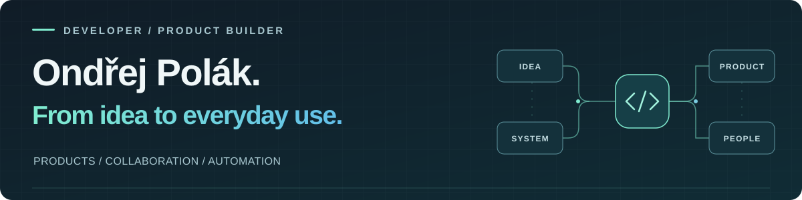
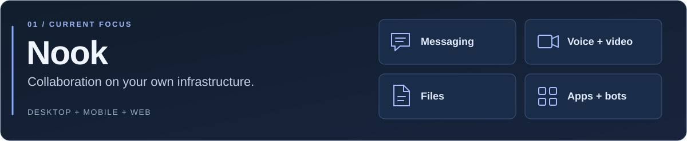
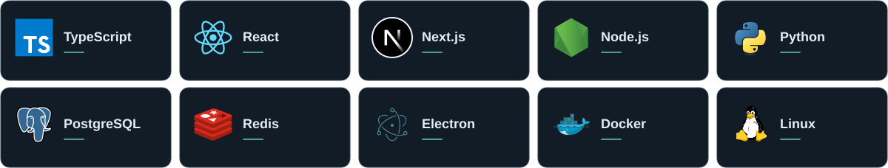

  

  <strong>Full-stack development · Self-hosted products · AI & automation</strong> 
  Building with <a href="https://github.com/CaludyLake">CloudyLake</a>

  <a href="#what-im-building">Projects</a> &nbsp; / &nbsp;
  <a href="#my-toolkit">Toolkit</a> &nbsp; / &nbsp;
  <a href="#how-i-work">How I work</a>

---

### Hi, I'm Ondřej.

I build collaboration platforms, business applications and automations — from the interface to the API and the infrastructure behind it. My work spans **web, desktop and mobile**, with a focus on **self-hosting, real-time systems and practical AI**.

Some days that means shaping a full product. Other days, it's a small integration that saves someone a dozen manual steps.

### What I'm building

My main product focus: a workspace for conversations, meetings, calls and files, running on your own infrastructure. I work on the experience across clients, the real-time backend and the permissions that connect them.

TypeScript · React · Fastify · PostgreSQL · Redis · Electron · React Native · LiveKit

 

| Product & business software | Automation & integrations |
| :--- | :--- |
| **Eclipse** A multi-tenant CMS and CRM platform for managing content and business workflows. React · Node.js · Express · MongoDB | **AI News Digest** A Python pipeline that collects AI news, uses an LLM to curate and summarise it, and delivers a daily Discord digest. Python · LLM integration · Discord |
| **Client applications** Offline-capable field-service workflows, structured forms and document generation. TypeScript · React · Offline sync | **Nook × Jira** An integration for creating Jira issues directly from a Nook conversation, with project and assignee selection. TypeScript · Jira API · Webhooks |

**For the gaming community:** [Albion Party Builder](https://github.com/opolak95/APB) and Discord tooling for Albion Online.

Most product and client code is private; the projects above describe what I build beyond the public repositories.

### My toolkit

<strong>The full stack — from interfaces to delivery</strong>

| Area | Technologies I work with |
| :--- | :--- |
| **Languages** | TypeScript, JavaScript, Python |
| **Interfaces** | React, Next.js, React Native / Expo, Electron, Tailwind CSS |
| **Backend & data** | Node.js, Fastify, Express, PostgreSQL, Redis, MongoDB |
| **Delivery & quality** | Docker, Linux, GitHub Actions, Vitest, Playwright |
| **AI & integrations** | Claude Code, Codex, LLM workflows, bots, APIs and webhooks |

### How I work

**Understand the workflow → Design the system → Build → Review & test → Ship**

- **Build the whole thing.** Connect the product idea to the interface, backend and deployment.
- **Make ownership practical.** Give teams control over their data and infrastructure.
- **Use AI deliberately.** Combine AI-assisted development and agent workflows with code review and checks that prove the important behaviour.
- **Automate the repeatable parts.** Leave more time for the decisions that need a person.

---

  <a href="https://github.com/CaludyLake">CloudyLake</a> &nbsp;·&nbsp;
  <a href="https://github.com/opolak95/APB">Explore Albion Party Builder</a>

