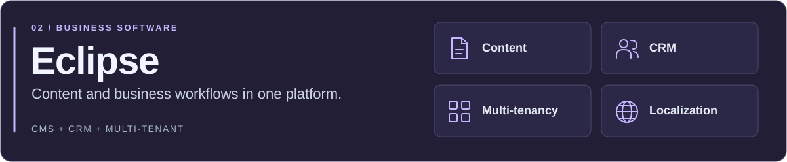
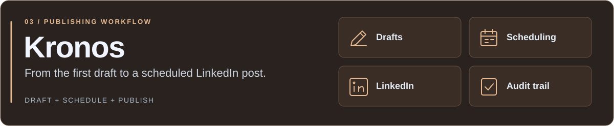
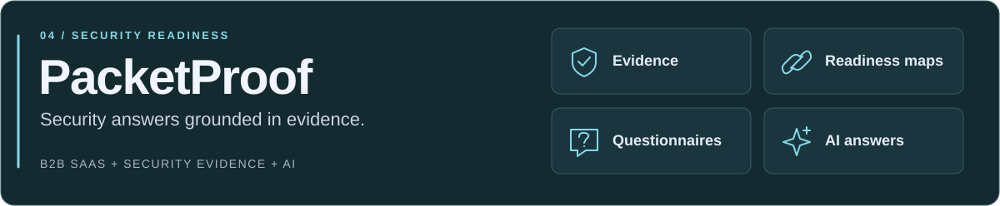
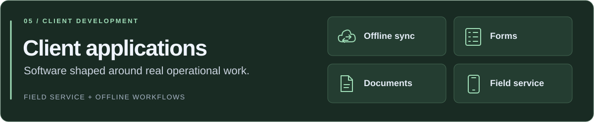
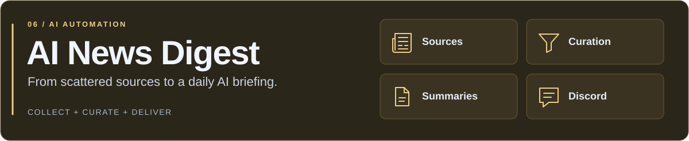
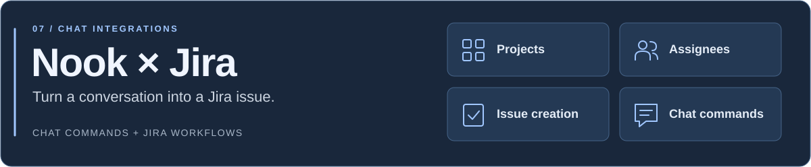

  

  <strong>Full-stack development · Self-hosted products · AI & automation</strong> 
  Building with <a href="https://github.com/CaludyLake">CloudyLake</a>

  <a href="#what-im-building">Projects</a> &nbsp; / &nbsp;
  <a href="#my-toolkit">Toolkit</a> &nbsp; / &nbsp;
  <a href="#how-i-work">How I work</a>

---

### Hi, I'm Ondřej.

I build collaboration platforms, business applications and automations — from the interface to the API and the infrastructure behind it. My work spans **web, desktop and mobile**, with a focus on **self-hosting, real-time systems and practical AI**.

Some days that means shaping a full product. Other days, it's a small integration that saves someone a dozen manual steps.

### What I'm building

<picture>
  <source media="(max-width: 640px)" srcset="./nook-mobile.svg" />
  
</picture>

My main product focus: a workspace for conversations, meetings, calls and files, running on your own infrastructure. I work on the experience across clients, the real-time backend and the permissions that connect them.

TypeScript · React · Fastify · PostgreSQL · Redis · Electron · React Native · LiveKit

 

<picture>
  <source media="(max-width: 640px)" srcset="./eclipse-mobile.svg" />
  
</picture>

A multi-tenant CMS and CRM platform for managing content and business workflows.

React · Node.js · Express · MongoDB

 

<picture>
  <source media="(max-width: 640px)" srcset="./kronos-mobile.svg" />
  
</picture>

An internal LinkedIn publishing platform for drafting, scheduling and publishing posts, with account management and an audit trail.

Next.js · TypeScript · Supabase · PostgreSQL · Prisma · Trigger.dev

 

<picture>
  <source media="(max-width: 640px)" srcset="./packetproof-mobile.svg" />
  
</picture>

A B2B platform for collecting security evidence, mapping readiness requirements and preparing evidence-backed answers to customer security questionnaires.

Next.js · TypeScript · Supabase · PostgreSQL · AI integration

 

<picture>
  <source media="(max-width: 640px)" srcset="./client-apps-mobile.svg" />
  
</picture>

Offline-capable field-service workflows, structured forms and document generation, shaped around the way people work in the field.

TypeScript · React · Offline sync

 

<picture>
  <source media="(max-width: 640px)" srcset="./ai-news-mobile.svg" />
  
</picture>

A Python pipeline that gathers AI news, uses an LLM to curate and summarise it, and delivers a daily Discord digest.

Python · LLM integration · Discord

 

<picture>
  <source media="(max-width: 640px)" srcset="./nook-jira-mobile.svg" />
  
</picture>

A chat integration for creating Jira issues directly from Nook, including project and assignee selection and a confirmation preview.

TypeScript · Jira API · Webhooks

 

**For the gaming community:** [Albion Party Builder](https://github.com/opolak95/APB) and Discord tooling for Albion Online.

Most product and client code is private; the projects above describe what I build beyond the public repositories.

### My toolkit

<picture>
  <source media="(max-width: 640px)" srcset="./toolkit-mobile.svg" />
  
</picture>

<strong>The full stack — from interfaces to delivery</strong>

| Area | Technologies I work with |
| :--- | :--- |
| **Languages** | TypeScript, JavaScript, Python |
| **Interfaces** | React, Next.js, React Native / Expo, Electron, Tailwind CSS |
| **Backend & data** | Node.js, Fastify, Express, PostgreSQL, Redis, MongoDB |
| **Delivery & quality** | Docker, Linux, GitHub Actions, Vitest, Playwright |
| **AI & integrations** | Claude Code, Codex, LLM workflows, bots, APIs and webhooks |

### How I work

**Understand the workflow → Design the system → Build → Review & test → Ship**

- **Build the whole thing.** Connect the product idea to the interface, backend and deployment.
- **Make ownership practical.** Give teams control over their data and infrastructure.
- **Use AI deliberately.** Combine AI-assisted development and agent workflows with code review and checks that prove the important behaviour.
- **Automate the repeatable parts.** Leave more time for the decisions that need a person.

---

  <a href="https://github.com/CaludyLake">CloudyLake</a> &nbsp;·&nbsp;
  <a href="https://github.com/opolak95/APB">Explore Albion Party Builder</a>

